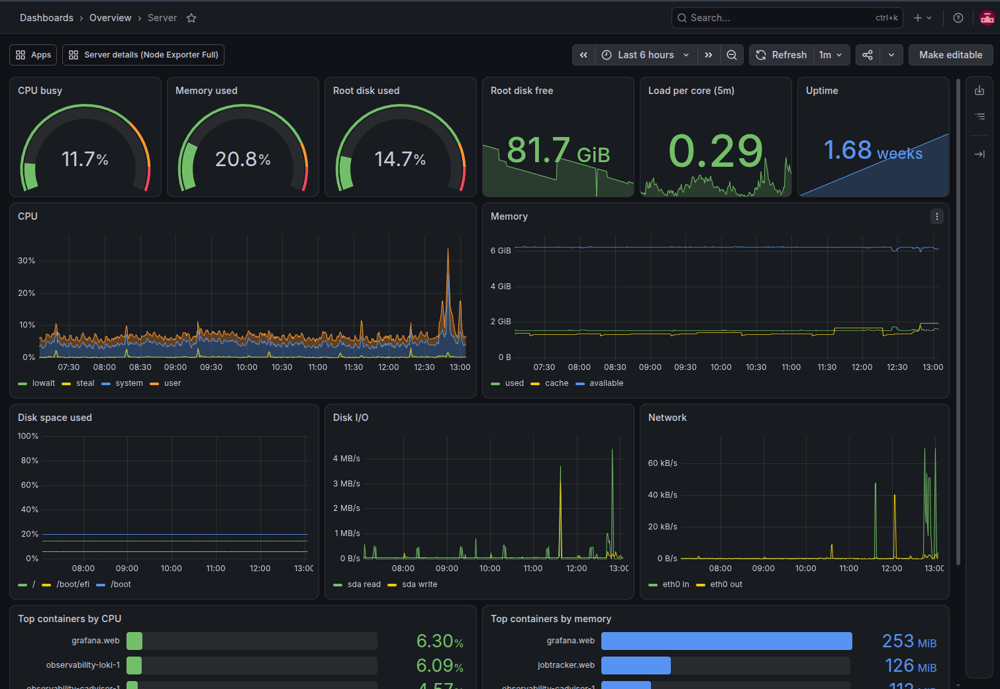
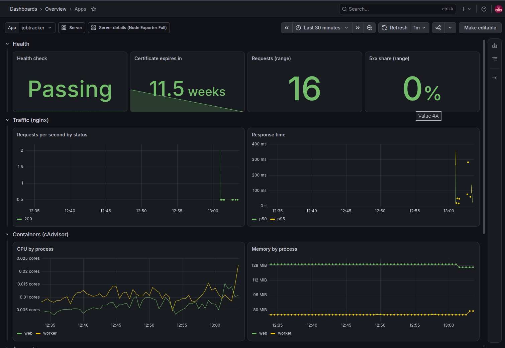

Dokku tells you an app deployed. It doesn't tell you the app has been returning 502s ever since.

`dokku logs` shows recent output and `docker stats` shows this second's resource use, but neither keeps a history that survives a redeploy. I wanted Dokku monitoring with one screen for "is the server okay?" and one for "is this app okay?", on the same host, with Grafana as the only new public endpoint. So I added an observability role to [ansible-server-bootstrap](https://github.com/thepsalmist/ansible-server-bootstrap), the playbook from the [previous post](/blog/dokku-ubuntu-ansible-bootstrap/).

> **TL;DR**
> - Six collectors run as a Compose project on a private Docker network. Grafana runs as a normal Dokku app, so it gets a domain and TLS like any other.
> - On Ubuntu 24.04, a fail2ban jail with a `logpath` silently watches nothing unless you set `backend = auto`.
> - Every per-app panel comes from things Dokku already has: nginx access logs, container labels and a `/healthz` route.
> - Two panels misled me: a "disk full in" projection, and cAdvisor container names stuck on Dokku's temporary `.upcoming` names.
> - On a lightly used host, the monitoring stack uses more memory than the apps it watches.

This is the Server dashboard the role provisions as Grafana's home page:



## Collectors in Compose, Grafana as a Dokku app

The stack is seven services: [Prometheus](https://prometheus.io/docs/), [Loki](https://grafana.com/docs/loki/latest/), [Alloy](https://grafana.com/docs/alloy/latest/) for log shipping, [node-exporter](https://github.com/prometheus/node_exporter) for host metrics, [cAdvisor](https://github.com/google/cadvisor) for container metrics, [blackbox-exporter](https://github.com/prometheus/blackbox_exporter) for health checks, and [Grafana](https://grafana.com/docs/grafana/latest/). Where each one runs came down to one question: does it serve the public?

The six collectors don't, and they need things Dokku apps aren't built for: host mounts, the host PID namespace, the Docker socket and, for cAdvisor, privileged mode. They run as a plain Compose project in `/opt/observability`.

Grafana does serve the public, so it needs a domain, an nginx vhost and a TLS certificate. Dokku already does that for every app, so Grafana is deployed as one.

That split has a cost. Prometheus, Alloy and cAdvisor can read the Docker socket, and cAdvisor runs privileged, so all three are effectively root. None of the collectors require authentication, so any app on their network can query them. I accept that because every app on this host is mine. With code you don't fully trust, you'd want separate networks or authentication in front of them.

## Keeping the exporters off the internet

Everything shares one Docker network, `observability`. Ansible creates it and the Compose file marks it external, because Dokku apps join it with [`dokku network:set <app> attach-post-create observability`](https://dokku.com/docs/networking/network/), and `docker compose down` would otherwise try to delete it from under them.

node-exporter was the awkward one. It needs host networking or it reports the container's interfaces instead of the server's, but host networking with the default listen address puts port 9100 on the public interface. The fix is to listen only on the Docker network's gateway, the host's side of the bridge:

```yaml
node-exporter:
  command:
    - --path.rootfs=/host
    - --web.listen-address=172.30.0.1:9100
  network_mode: host
  pid: host
```

Then Prometheus couldn't reach it either. Traffic from a container to the host's own address goes through the host's INPUT chain, which ufw denies by default. It's the reverse of the [Docker-bypasses-ufw problem](/blog/dokku-ubuntu-ansible-bootstrap/#what-it-doesnt-protect-you-from), and one rule fixes it: allow `172.30.0.0/24` to reach `172.30.0.1` on port 9100. Nothing else in the stack publishes a port.

## Deploying Grafana through Dokku, in the right order

With the collectors private, Grafana is the one public piece. It runs from a pinned image with `git:from-image`, keeps its database on a storage mount, and reads its datasources and dashboards from a read-only mount of the repo, so the provisioned dashboards live in Git rather than in Grafana's database.

Two Dokku behaviours decided the order of the steps:

- **`domains:set` clears the port mapping on an app that hasn't been deployed yet.** Set the port first and a fresh Grafana comes up with no mapping, so the domain goes first.
- **[`ports:set` force-sets the mapping list](https://dokku.com/docs/networking/port-management/), while `ports:add` appends to it.** `letsencrypt:enable` adds an HTTPS mapping that a later `ports:set http:80:3000` would quietly delete, so the role only uses `ports:add`.

## A fail2ban jail that ignored its log file

Being public, Grafana also has to survive password guessing. It [locks an account after five failed logins in five minutes](https://grafana.com/docs/grafana/latest/setup-grafana/configure-grafana/#disable_brute_force_login_protection), which protects the account but not the server. So a fail2ban jail reads Grafana's access log and bans an address after five failed logins in ten minutes:

```ini
[grafana]
enabled  = true
backend  = auto
logpath  = /var/log/nginx/grafana-access.log
maxretry = 5
findtime = 10m
bantime  = 1h
```

Without `backend = auto`, the jail starts, reports itself active and never bans anyone. [Ubuntu 24.04's fail2ban package sets `backend = systemd` as the default](https://git.launchpad.net/ubuntu/+source/fail2ban/plain/debian/debian-files/jail.d_defaults-debian.conf?h=ubuntu/noble), in `/etc/fail2ban/jail.d/defaults-debian.conf`,, which reads the journal and ignores `logpath`. nginx writes to a file, so the jail was watching nothing. The tell is `fail2ban-client status grafana` showing zero failures right after you type a wrong password on purpose.

## Per-app dashboards from Dokku's own logs and labels

With the stack running privately and Grafana public, the next problem was a per-app dashboard that works for any app without touching its code:



| Panel | Where it comes from | What the app has to provide |
|---|---|---|
| Requests, 5xx share, response time | Dokku's nginx access log, parsed in Loki | Nothing |
| CPU and memory by process | cAdvisor, grouped by Dokku's `web` / `worker` labels | Nothing |
| Logs | Container output, shipped to Loki | Nothing |
| Health check, certificate expiry | blackbox-exporter requesting `https://<domain>/healthz` | A `/healthz` route that returns 200 |
| App metrics (optional) | Prometheus scraping the container | A metrics endpoint on the `observability` network |

The health check is the one assumption: an app without `/healthz` shows as failing even while it serves users perfectly well.

Nobody maintains the list of health checks. On every run, the role asks Dokku for its apps and their domains and writes them to a file Prometheus watches. Because the probe is a real HTTPS request to the real domain, it also reports certificate expiry, which is how I'd find out Let's Encrypt renewals had stopped before a browser did.

Apps that expose their own Prometheus metrics opt in with a container label:

```bash
dokku docker-options:add myapp deploy "--label observability.metrics.port=9000"
dokku network:set myapp attach-post-create observability
dokku ps:rebuild myapp
```

Prometheus finds them through the Docker socket and scrapes them on the private network. Don't run `dokku ports:add` for the metrics port: that tells Dokku's nginx to proxy it publicly.

## Structured nginx logs with only three Loki labels

Dokku's nginx writes plain-text access logs. The role sets a JSON format as Dokku's global default, so every request becomes one JSON object:

```nginx
log_format dokku_json escape=json '{"time":"$time_iso8601","host":"$host","remote_addr":"$remote_addr","method":"$request_method","path":"$uri","status":$status,"bytes":$body_bytes_sent,"request_time":$request_time,"upstream_time":"$upstream_response_time","user_agent":"$http_user_agent"}';
```

`path` is [`$uri`, not `$request_uri`](https://nginx.org/en/docs/http/ngx_http_core_module.html#var_uri), so query strings, which often carry tokens, stay out of it. `status` and `request_time` are unquoted, so queries can compare and average them as numbers.

The bigger decision is what not to turn into labels. [Each distinct combination of label values is a separate Loki stream](https://grafana.com/docs/loki/latest/get-started/labels/), so labelling by path or IP would multiply streams and bloat the index. Labels stay at `job`, `app` and `container`, and everything else is parsed at query time:

```logql
{job="nginx", app="myapp"} | json | status >= 500
```

That covers every request panel on the dashboard, with no instrumentation in the app.

## Two dashboard panels that misled me

Both of these looked completely reasonable, and both were wrong.

**"Root disk full in" predicted a full disk that wasn't coming.** The tile projected when the disk would fill from how fast free space had fallen over six hours, using [`deriv`](https://prometheus.io/docs/prometheus/latest/querying/functions/#deriv):

```promql
(node_filesystem_avail_bytes{mountpoint="/"} / -deriv(node_filesystem_avail_bytes{mountpoint="/"}[6h])) > 0
```

Every Dokku deploy pulls images and builds layers, so free space drops sharply for a few minutes. A straight line through six hours of that projects the dip forward, and a mostly empty disk read as days from full. Disk use on a deploy server moves in steps, not trends. The tile now shows free space, 81.7 GiB in the screenshot, which is the number I'd actually act on.

**Every container kept its temporary name for life.** Dokku starts a new container under a name like `jobtracker.web.1.upcoming-12345`, checks it's healthy, then renames it. cAdvisor kept the first name it saw, so the "top containers" panels showed `.upcoming` names for containers that had been running for days. The fix is to build the name from Dokku's labels, which never change, with [`label_join` and `label_replace`](https://prometheus.io/docs/prometheus/latest/querying/functions/#label_join):

```promql
sort_desc(topk(8, sum by (name) (
  label_replace(
    label_join(
      container_memory_working_set_bytes{name!=""},
      "dokku", ".", "container_label_com_dokku_app_name", "container_label_com_dokku_process_type"),
    "name", "$1", "dokku", "(.+[.].+)")
)))
```

`label_join` builds `app.process`, and `label_replace` uses it only when both halves exist, so Compose containers keep their own names. That's why the dashboard shows `grafana.web` and `jobtracker.worker` next to `observability-loki-1`.

## Running it yourself

This assumes the host was set up with the [bootstrap playbook](/blog/dokku-ubuntu-ansible-bootstrap/); the role isn't a standalone installer. Point a DNS record at the server and add three settings:

```yaml
# group_vars/all.yml
observability_grafana_domain: monitoring.example.com
observability_grafana_admin_password: "..."     # 16+ characters; vault it
dokku_letsencrypt_email: you@example.com
```

```bash
ansible-playbook site.yml --tags dokku,observability --ask-vault-pass
```

The `dokku` tag applies the Let's Encrypt email that Grafana's certificate depends on.

The rule that shaped the whole setup: anything that needs host access runs outside Dokku and stays private, and anything that serves the public goes through Dokku like any other app. The price is memory: with two lightly used apps, Grafana alone uses more than either of them, so on a small server, check the containers panel before adding more.

These dashboards can tell me an app is slow, but not which query or API call made it slow. Tracing closes that gap, and it's the [next post](/blog/dokku-opentelemetry-tempo-tracing/).
