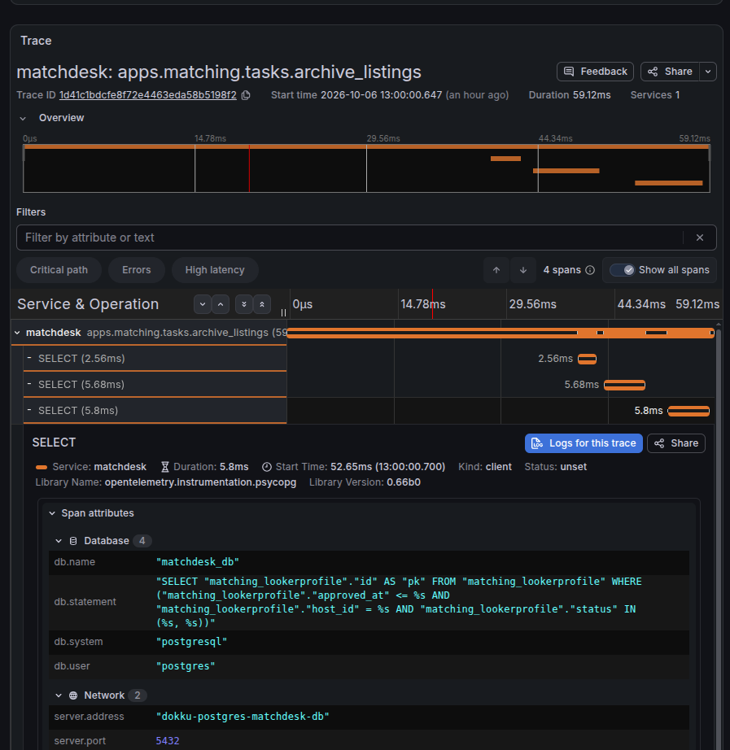

Ask a Python app running four worker processes how many requests it has served, and the answer depends on which worker you happen to ask.

That's what a plain Prometheus scrape does. The app server hands the `/metrics` request to whichever worker picks it up, and that worker reports its own counters, not the app's. Prometheus sees a counter jumping up and down and reads every drop as a restart. It was the gap in my [Dokku monitoring](/blog/dokku-monitoring-prometheus-loki-grafana/), along with a bigger one: the dashboards could tell me an app was slow, but not why.

So my apps now push OpenTelemetry traces and metrics. Traces go to [Grafana Tempo](https://grafana.com/docs/tempo/latest/), metrics go to the same Prometheus, and a log line with a trace ID links to its trace. It's deployed by the same [Ansible playbook](https://github.com/thepsalmist/ansible-server-bootstrap), and nothing new is published on the host.

> **TL;DR**
> - Each process pushes its own metrics and traces over OTLP to Alloy, so there's no per-worker scrape problem and no metrics port to expose.
> - Alloy copies `service.name` into an `app` label, so pushed metrics line up with the existing logs and container dashboards.
> - Set `service.instance.id` per process, or every worker writes to the same series and you're back to the original bug.
> - Set `out_of_order_time_window` in Prometheus, or batched pushes quietly leave gaps.
> - Writing `trace_id` into JSON logs gives one-click links between Loki and Tempo.

Here's one run of a scheduled background job in one of my apps:



The run took 59 ms. Its three database queries, recorded automatically by the Postgres driver's instrumentation, account for about 14 ms, and the first doesn't start until roughly 40 ms in. The previous dashboards could never have shown that. It also shows tracing's limit: it only sees what's instrumented, so those first 40 ms stay blank until I add spans of my own.

## Pushing metrics instead of scraping them

The Python Prometheus client does have a fix for multiple workers, [multiprocess mode](https://prometheus.github.io/client_python/multiprocess/): each worker writes metrics to files in a shared directory and one endpoint adds them up. It works, but gauges need a rule for combining values, some metric types aren't supported, and the directory has to be wiped between restarts.

Turning the flow around was the better trade. Instead of Prometheus pulling from each app, each process pushes its own metrics over OTLP, the OpenTelemetry protocol:

- **Each process reports for itself**, so nothing has to aggregate across workers.
- **There's no metrics port.** The previous post warned that `dokku ports:add` on a metrics port makes it public. With push, there's nothing to get wrong.
- **One SDK covers traces and metrics**, sent to the same endpoint with the same configuration.

The scrape path stays in the playbook for apps that already use it. New instrumentation pushes.

## Alloy as the single OTLP receiver, on a private network

Grafana Alloy already shipped logs on this server, and it can also [receive OTLP](https://grafana.com/docs/alloy/latest/reference/components/otelcol/otelcol.receiver.otlp/), so it became the single place apps send telemetry:

```
app ──OTLP──▶ Alloy (alloy:4317 gRPC, alloy:4318 HTTP)
                ├── traces  ─▶ Tempo
                └── metrics ─▶ Prometheus (OTLP receiver)
```

```alloy
otelcol.receiver.otlp "apps" {
  grpc {
    endpoint = "0.0.0.0:4317"
  }

  http {
    endpoint = "0.0.0.0:4318"
  }

  output {
    metrics = [otelcol.processor.transform.app_label.input]
    traces  = [otelcol.processor.batch.default.input]
  }
}

otelcol.processor.batch "default" {
  output {
    metrics = [otelcol.exporter.otlphttp.prometheus.input]
    traces  = [otelcol.exporter.otlp.tempo.input]
  }
}
```

[Prometheus 3 accepts OTLP directly](https://prometheus.io/docs/guides/opentelemetry/) when started with `--web.enable-otlp-receiver`, so metrics need no separate gateway. Tempo is the one new service, with local disk storage and seven days of retention.

The OTLP ports listen only on the `observability` Docker network, which apps join with `network:set ... attach-post-create`. Use that rather than `attach-post-deploy`: a container starts before post-deploy attaches it, so it loses whatever it sends until then, and `dokku run` containers never join at all. Nothing is published on the host and ufw needs no new rule. The trust boundary is unchanged: any app on that network can send telemetry, and every app on this server is mine.

## Giving pushed metrics the same app label as everything else

Every dashboard on this server filters on an `app` label taken from Dokku's container labels. Pushed metrics don't come from a container Prometheus is watching, so they don't have one. When Prometheus translates OTLP, [it maps `service.name` and `service.instance.id` to `job` and `instance`](https://prometheus.io/docs/guides/opentelemetry/), and other resource attributes stay on `target_info` unless you promote them.

Two small pieces of config close the gap. Alloy copies `service.name` into an `app` attribute:

```alloy
otelcol.processor.transform "app_label" {
  error_mode = "ignore"

  metric_statements {
    context    = "resource"
    statements = [`set(resource.attributes["app"], resource.attributes["service.name"])`]
  }

  output {
    metrics = [otelcol.processor.batch.default.input]
  }
}
```

and Prometheus promotes it, plus two others, to labels on every series:

```yaml
otlp:
  promote_resource_attributes: [app, process_type, deployment.environment]
```

The contract for an app is then one environment variable: set `OTEL_SERVICE_NAME` to the Dokku app name, and its metrics carry the same `app` label as its logs, container metrics and health check.

## Every worker needs its own instance ID

Pushing also hands Prometheus two things it used to decide for itself: which process a sample belongs to, and when it arrives. Both caused problems.

Pushing fixes the four-workers problem only if Prometheus can tell the workers apart, and that's the `instance` label, from `service.instance.id`. Leave it unset and every worker writes to the same series. If worker one reports 1,200 requests and worker two reports 900 a second later, Prometheus stores them as consecutive samples of one counter, which looks like a reset. It's the scrape bug again, by a different route.

Environment variables can't fix this, because Dokku config is the same for every process of an app. So the app sets two resource attributes at startup: `service.instance.id`, unique per process (hostname plus PID), and `process_type`, `web` or `worker`, so dashboards can split them the way they already do for container metrics:

```python
import os
import socket

from opentelemetry import metrics, trace
from opentelemetry.exporter.otlp.proto.http.metric_exporter import OTLPMetricExporter
from opentelemetry.exporter.otlp.proto.http.trace_exporter import OTLPSpanExporter
from opentelemetry.sdk.metrics import MeterProvider
from opentelemetry.sdk.metrics.export import PeriodicExportingMetricReader
from opentelemetry.sdk.resources import Resource
from opentelemetry.sdk.trace import TracerProvider
from opentelemetry.sdk.trace.export import BatchSpanProcessor


def setup_telemetry(process_type: str) -> None:
    resource = Resource.create({
        "process_type": process_type,
        "service.instance.id": f"{socket.gethostname()}-{os.getpid()}",
    })

    tracer_provider = TracerProvider(resource=resource)
    tracer_provider.add_span_processor(BatchSpanProcessor(OTLPSpanExporter()))
    trace.set_tracer_provider(tracer_provider)

    reader = PeriodicExportingMetricReader(OTLPMetricExporter())
    metrics.set_meter_provider(MeterProvider(resource=resource, metric_readers=[reader]))
```

`Resource.create` still merges in `service.name` and `deployment.environment` from the `OTEL_*` environment variables, so those stay in Dokku config. Call it once in each process, [after any fork](https://opentelemetry-python.readthedocs.io/en/latest/examples/fork-process-model/README.html). The exporters run background threads, and a thread started before a fork doesn't exist in the child.

## Prometheus drops out-of-order samples

The second problem is timing. Scraped samples arrive in order, because Prometheus decides when to collect them. Pushed samples can arrive out of order after batching or retries, and by default Prometheus rejects a sample older than one it already has for that series. [Its OTLP guide recommends](https://prometheus.io/docs/guides/opentelemetry/) a window that accepts them:

```yaml
storage:
  tsdb:
    out_of_order_time_window: 30m
```

It's easy to miss: the rejections only appear in Alloy's and Prometheus's own logs. On the dashboards, they're just gaps.

## Linking logs and traces in Grafana

With metrics lined up, the traces needed to connect to the logs. Logs stay on stdout, where Dokku and Loki already handle them. Alloy isn't set up to receive OTLP logs, so if your SDK setup exports logs by default, set [`OTEL_LOGS_EXPORTER=none`](https://opentelemetry.io/docs/specs/otel/configuration/sdk-environment-variables/). If an app writes `trace_id` as a field in its JSON logs, a [derived field](https://grafana.com/docs/grafana/latest/datasources/loki/configure/) on the Loki datasource turns it into a link:

```yaml
derivedFields:
  - name: trace_id
    matcherRegex: '"trace_id":\s*"(\w+)"'
    datasourceUid: tempo
    url: "$${__value.raw}"
    urlDisplayLabel: View trace
```

The [Tempo datasource](https://grafana.com/docs/grafana/latest/datasources/tempo/configure-tempo-data-source/configure-trace-to-logs/) links the other way: from any span, Grafana opens that app's logs within five minutes either side, filtered on the trace ID, by mapping `service.name` to Loki's `app` label:

```yaml
tracesToLogsV2:
  datasourceUid: loki
  spanStartTimeShift: -5m
  spanEndTimeShift: 5m
  filterByTraceID: true
  tags:
    - key: service.name
      value: app
```

Both directions rely on the same convention as the metrics: the service name is the Dokku app name. One name joins all three signals.

## Running it yourself

On a host set up with the [bootstrap playbook](/blog/dokku-ubuntu-ansible-bootstrap/), re-run the observability role, then point an app at Alloy:

```bash
ansible-playbook site.yml --tags observability

dokku network:set myapp attach-post-create observability
dokku config:set myapp \
  OTEL_EXPORTER_OTLP_ENDPOINT=http://alloy:4318 \
  OTEL_SERVICE_NAME=myapp \
  OTEL_LOGS_EXPORTER=none \
  OTEL_RESOURCE_ATTRIBUTES=deployment.environment=production
```

To check the pipeline before touching an app, send a test trace and metric with [`telemetrygen`](https://github.com/open-telemetry/opentelemetry-collector-contrib/tree/main/cmd/telemetrygen) and look for them in Tempo and Prometheus:

```bash
tg=ghcr.io/open-telemetry/opentelemetry-collector-contrib/telemetrygen
docker run --rm --network observability $tg traces --traces 1 --otlp-http --otlp-endpoint alloy:4318 --otlp-insecure --service otlptest
docker run --rm --network observability $tg metrics --metrics 1 --otlp-http --otlp-endpoint alloy:4318 --otlp-insecure --service otlptest
docker run --rm --network observability curlimages/curl -s -G http://tempo:3200/api/search --data-urlencode 'q={}'
docker run --rm --network observability curlimages/curl -s -G http://prometheus:9090/api/v1/series --data-urlencode 'match[]={app="otlptest"}'
```

If the last command returns series labelled `app="otlptest"`, the label mapping works end to end.

The decision rule I'd keep: scrape when one process can answer for the whole app, and push when an app runs several processes or you want traces anyway, since the same SDK sends both.

Tempo adds one more service to a stack that already outweighs the apps it watches. In return, that 59 ms trace raised a question I couldn't have asked before: what the job does for 40 ms before its first query. Next is alerting that uses all three signals: a failing health check, a spike in 5xx, and the slow trace that explains it. That's a post of its own.
