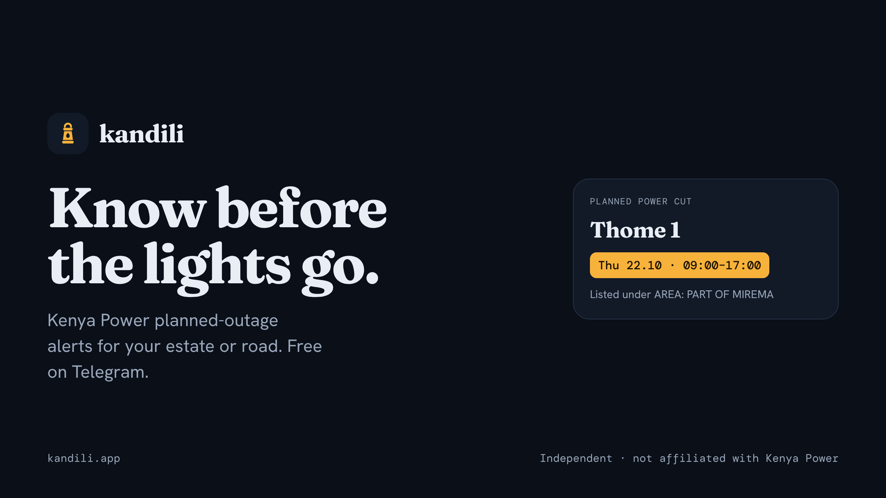
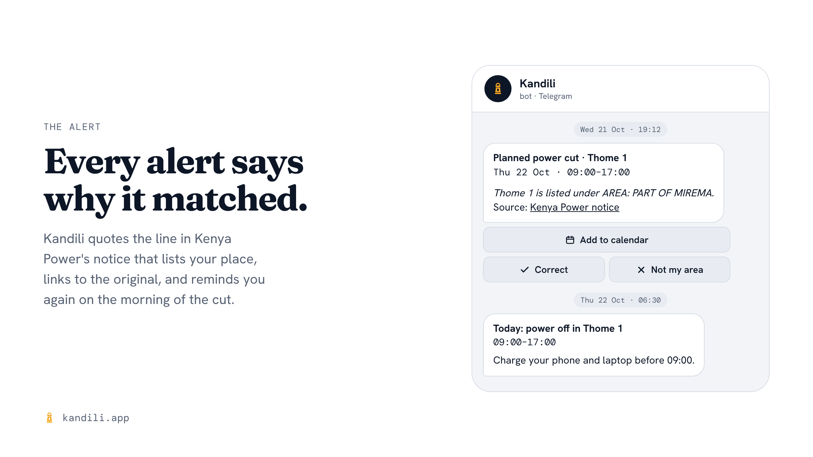
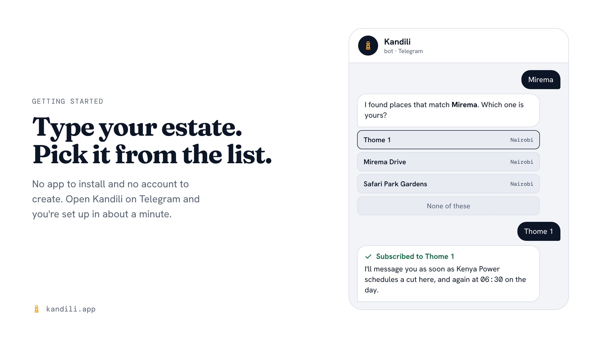
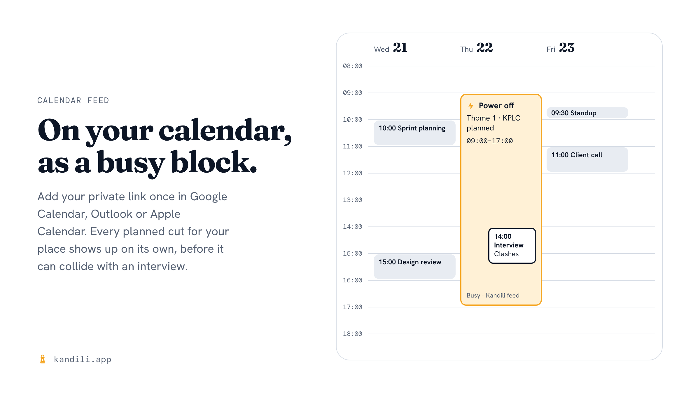

One Thursday, the power in my area went off and stayed off for most of the day.

I work remotely. When the power goes, the Wi-Fi goes with it, and the workday goes after that.

Later I found out the outage had been planned. Kenya Power had published a notice for it: a PDF on their website and an image on X. I just never saw it.

That's the part that bothered me. If I had known the night before, I would have charged everything, moved my calls and found somewhere with power to work from. A planned outage is only a problem when it catches you by surprise.

And it catches almost everyone by surprise, because nobody checks kplc.co.ke every evening. The notice exists. Nobody delivers it to the people it's about.

So I built **Kandili**.

## What Kandili does

Kandili sends you Kenya Power's planned outage notices for **your** estate or road before the day comes, and puts them on your calendar.

You tell it where you live or work, for example "Mirema" or "Pride Park". Then:

- **As soon as a notice is published** that includes your place, you get a message.
- **At 6:30 a.m. on the day of the outage**, you get a reminder.
- **Your calendar shows the outage as a busy block**, so it doesn't collide with a meeting or an interview. It works with Google Calendar, Outlook and Apple Calendar through a private link.

Here's what an alert looks like:

Two details in each alert matter most. The **why** line shows exactly which part of the notice matched your place, so you can judge it yourself. The **source** link opens Kenya Power's original notice, so you can check it.

## Who it's for

- **Remote and hybrid workers.** You can plan around eight hours without power. You can't plan around eight hours you didn't know were coming.
- **Small businesses that run on power.** Salons, barbers, cyber cafés, print shops, butcheries, home bakers. Knowing the night before means time to move bookings, charge up or fuel the generator.
- **Households and estates.** Anyone who has opened the fridge after a long cut. Caretakers and residents' association admins can forward alerts straight to the estate group.

## Get started in under a minute

Kandili runs on Telegram today. There's no app to install and no account to create.

1. Open **[Kandili on Telegram](https://t.me/kandili_dev_bot)** and tap **Start**.
2. Type the name of your estate, road or area, for example `Mirema`.
3. Pick the right match from the short list. The same name can turn up in more than one county, so Kandili asks rather than guesses.
4. You're subscribed. Send `my areas` any time to see what you follow, or `stop` to pause alerts.

Then send `/calendar`, and the bot gives you a private calendar link. Add it once in Google Calendar, Outlook or Apple Calendar, and every outage for your place shows up there on its own.

Not on Telegram? You can [get the same alerts by email](https://kandili.app/email). **WhatsApp support is coming soon.**

## What it costs, and what it isn't

**Following one place is free, and it'll stay free.** That covers alerts on Telegram or by email, the 6:30 a.m. reminder and the calendar feed. **Plus** follows up to three places for KSh 499 a year, paid once by M-Pesa. Nothing renews by itself. WhatsApp alerts will join Plus when they launch.

**You can also chip in.** If Kandili has saved you a spoiled fridge or a lost workday, you can [chip in](https://kandili.app/chip-in) from KSh 50 by M-Pesa. It's a one-off contribution: nothing repeats, and you don't need to subscribe to a plan.

**Kandili isn't Kenya Power.** It's an independent service made by Novazury Labs. Every alert links to Kenya Power's original notice, so you can always check the source.

**It covers planned outages only, for now.** If a transformer blows or a line comes down in the rain, no notice exists for that, so Kenya Power's own channels are still where you report it. Community reporting is coming soon: you'll be able to report an unplanned outage in your area and see what your neighbours have reported.

## Under the hood

A brief technical overview for engineers. A detailed write-up of the parser will be published in a follow-up post.

- **Source.** Kenya Power publishes planned interruptions as PDFs with a real text layer, so there's no OCR. Every notice follows the same shape: region, an optional county, `AREA:`, `DATE: … TIME: …`, then a comma-separated list of places ending in "& adjacent customers."
- **Parser.** A line-based state machine turns that text into outages. Each outage passes validators before anyone hears about it: the date must fall within two weeks of publication, start must come before end, the weekday must match the date, and there must be at least one place. Anything that fails goes to a manual review queue instead of to subscribers, so a notice with a mistyped year never becomes an alert. The notice that started this project is the first test case in the suite.
- **Matching.** Place names are normalised (`Apats` → Apartments, `Hosp` → Hospital) and fuzzy-matched against a gazetteer of Kenyan estates and roads that grows with every notice. Each alert stores the reason it matched.
- **Delivery.** Sends are idempotent: one alert per subscription, per outage, per kind, enforced by a database constraint, so a retry can't message you twice.
- **Stack.** Python and PostgreSQL. Postgres also runs the job queue and the fuzzy search, so there is no additional infrastructure to operate. The whole service runs on a single small server.

## Try it, and tell your neighbours

If you've ever lost a day, a client or a fridge full of food to a power cut you could have planned for, Kandili is for you.

**[Start Kandili on Telegram →](https://t.me/kandili_dev_bot)**

Setup takes about a minute. If you find it useful, share this post with your estate WhatsApp group: Kandili improves with every place people subscribe to. And if it has already saved you a day, you can [chip in to keep Kandili on](https://kandili.app/chip-in).

*Kandili is Swahili for the kerosene lantern most of us still keep somewhere for when the power goes. The aim is that you'll need yours less often.*

**Know before the lights go.**
