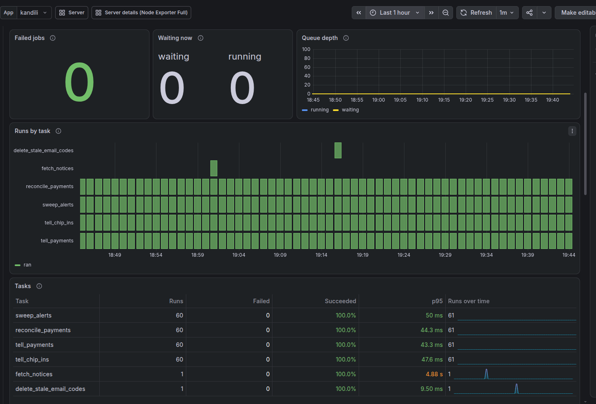

[Procrastinate](https://procrastinate.readthedocs.io/en/stable/) is a Python task queue that keeps its jobs in a Postgres table. That one design choice decides more than where the queue lives: in Django, a job deferred inside a transaction commits or rolls back with your data. From a SQLAlchemy session, it doesn't.

I run two apps on it, both moved from Celery: a Django app, and [Kandili](/projects/kandili/), a FastAPI service that sends alerts for planned power outages in Kenya. Both are deployed on the same [Dokku server](/blog/dokku-ubuntu-ansible-bootstrap/). Redis is still there for caching and sessions; only the background jobs moved. This guide follows the path I took in both: installing it, deferring jobs safely, scheduling them, cleaning up after them, and watching them in Grafana.

> **TL;DR**
> - In Django, defer a job inside `transaction.atomic()` and it commits or rolls back with your data. No `transaction.on_commit` needed.
> - From a SQLAlchemy session, a deferred job survives a rollback. Have requests write rows with a status and let a periodic task queue them.
> - Periodic tasks run on UTC cron. I use `queueing_lock` on them rather than `lock`, because a killed worker can leave a `lock` held.
> - Procrastinate keeps every finished job by default. Four every-minute tasks added 5,803 rows a day until I set `delete_jobs`.
> - A worker middleware and one SQL query give you job counts, durations and queue depth in Grafana.

## Why keep background jobs in Postgres instead of Redis

With Celery, the queue lives in a broker (Redis, in my case) and your data lives in Postgres. They can disagree: a job can reach a worker before the transaction that created it has committed, or survive a rollback that removed the row it refers to.

Procrastinate puts the queue in the database you already run. A deferred job is a row in `procrastinate_jobs`. Workers claim jobs with `SELECT ... FOR UPDATE SKIP LOCKED`, so two workers never take the same one, and Postgres `LISTEN/NOTIFY` wakes them as soon as a job arrives rather than at their next poll. A few things follow from that:

| | Celery + Redis | Procrastinate |
|---|---|---|
| Where a job lives | A message in the broker | A row in Postgres |
| Job created in a rolled-back transaction | Still sent, unless you use `on_commit` | Depends on the framework (below) |
| Inspecting failed jobs | Flower or the result backend | A SQL query |
| Workflows (chains, chords) | Built in | Not available |

That last row is the main trade-off. For pipelines of dependent tasks, or very high job throughput, Celery is a better fit. Most of what my apps do is "send this email later" or "run this every minute", which doesn't need a broker.

## Setting up Procrastinate in a Django app

Install it with the Django extra and add the app. It uses your default database, so there's no connection string to configure:

```bash
pip install "procrastinate[django]"
```

```python
INSTALLED_APPS = [
    ...,
    "procrastinate.contrib.django",
]
```

`python manage.py migrate` creates Procrastinate's tables. Tasks go in a `tasks.py` module in any installed app, which Procrastinate [discovers on startup](https://procrastinate.readthedocs.io/en/stable/howto/django/basic_usage.html):

```python
from procrastinate import RetryStrategy
from procrastinate.contrib.django import app

EMAIL_RETRY = RetryStrategy(max_attempts=3, exponential_wait=10)


@app.task(retry=EMAIL_RETRY)
def send_confirmation(booking_id):
    booking = Booking.objects.get(pk=booking_id)
    send_email(booking.customer.email, "Your booking is confirmed")
```

Calling `send_confirmation.defer(booking_id=booking.pk)` from a view inserts a job. Set a [retry strategy](https://procrastinate.readthedocs.io/en/stable/howto/advanced/retry.html) on anything that calls another service, or one timeout fails the job for good.

The worker is a management command. On Dokku, that's one more line in the Procfile, with migrations in the release phase so the tables exist before either process starts:

```
web: gunicorn config.wsgi --bind 0.0.0.0:8000 --workers 3
worker: python manage.py procrastinate worker
release: python manage.py migrate --noinput
```

## In Django, a deferred job commits or rolls back with your data

Procrastinate's [Django connector](https://github.com/procrastinate-org/procrastinate/blob/main/procrastinate/contrib/django/django_connector.py) doesn't open its own database connection. It uses Django's, so `defer` runs inside whatever transaction Django has open. The change and the job that reacts to it commit together, or not at all:

```python
def accept(customer, public_id):
    with transaction.atomic():
        booking = Booking.objects.select_for_update().get(
            public_id=public_id, customer=customer, status=Status.AWAITING
        )
        booking.status = Status.ACCEPTED
        booking.save()
        send_confirmation.defer(booking_id=booking.pk)
    return booking
```

With Celery, the same code needs the job sent from [`transaction.on_commit`](https://docs.djangoproject.com/en/stable/topics/db/transactions/#performing-actions-after-commit) (which Celery now wraps as [`delay_on_commit`](https://docs.celeryq.dev/en/main/_modules/celery/contrib/django/task.html)), or the worker can run before the booking is saved. My Django app defers jobs from about 20 places like this and has no `on_commit` anywhere.

Procrastinate's Django docs don't state this guarantee, so I tested it: insert a row and defer a job inside `atomic()`, then raise an exception. Both were gone.

## Setting up Procrastinate in a FastAPI app

There's no FastAPI integration, but Procrastinate works without one. You create an `App` with a connector pointing at your database, and define tasks on it:

```python
from procrastinate import App, PsycopgConnector

app = App(connector=PsycopgConnector(conninfo=settings.database_url))


@app.task(name="send_alert", retry=SEND_RETRY)
async def send_alert(alert_id: int) -> None:
    ...
```

Tasks can be sync or async. The worker is a small module of its own, which gives you one place to set worker options later:

```python
import asyncio

from app.jobs import app


async def main() -> None:
    async with app.open_async():
        await app.run_worker_async()


if __name__ == "__main__":
    asyncio.run(main())
```

```
web: uvicorn app.main:app --host 0.0.0.0 --port 8000
worker: python -m app.worker
release: alembic upgrade head
```

With Alembic, the schema is a migration you write yourself:

```python
from alembic import op
from procrastinate.schema import SchemaManager


def upgrade() -> None:
    op.execute(SchemaManager.get_schema())
```

Then tell autogenerate the tables aren't yours, in `migrations/env.py`, or every new revision tries to drop them:

```python
def include_name(name, type_, parent_names):
    return not (type_ == "table" and name.startswith("procrastinate_"))
```

Pass `include_name=include_name` to both `context.configure` calls. Notice the web process isn't in any of this. That's deliberate, and the next section is why.

## A job deferred from a SQLAlchemy session survives a rollback

FastAPI apps usually write through SQLAlchemy sessions, and none of Procrastinate's connectors can join one. `PsycopgConnector` keeps its own connection pool. Procrastinate's [SQLAlchemy connector](https://github.com/procrastinate-org/procrastinate/blob/main/procrastinate/contrib/sqlalchemy/psycopg2_connector.py) looks like the fix, but even when you pass it your engine, it runs each query on a fresh connection in its own transaction.

I ran the same test on all three setups with Procrastinate 3.10: insert a row, defer a job, roll back.

| Setup | Rows left | Jobs left |
|---|---|---|
| Django connector, inside `atomic()` | 0 | 0 |
| `PsycopgConnector` + SQLAlchemy session | 0 | 1 |
| SQLAlchemy connector sharing the app's engine | 0 | 1 |

The job is committed the moment `defer` returns. If the request then fails, a worker runs a job for a row that doesn't exist. Defer after `session.commit()` instead, and the opposite can happen: the row commits, the process dies, and no job is ever queued.

So in Kandili, requests don't defer jobs. They write rows with a status, inside their normal transaction. An alert is created as `pending`, and a periodic task turns pending rows into jobs every minute:

```python
@app.periodic(cron="* * * * *")
@app.task(name="sweep_alerts")
def sweep_alerts(timestamp: int) -> None:
    with SessionLocal() as session:
        due = due_alert_ids(session)
    for alert_id in due:
        with suppress(AlreadyEnqueued):
            send_alert.configure(queueing_lock=f"send_alert:{alert_id}").defer(
                alert_id=alert_id
            )
```

`send_alert` claims its row with `UPDATE ... WHERE status = 'pending' RETURNING`, sends, and records the outcome. A rolled-back request leaves no row, so nothing is sent. A crash after the commit leaves a pending row, and the next sweep picks it up. This is the [transactional outbox](https://microservices.io/patterns/data/transactional-outbox.html) pattern, with the table as the source of truth and Procrastinate as the clock and retry engine. The cost is up to a minute of delay, which is fine for an alert and maybe not for a password reset.

## Scheduling periodic tasks in UTC with a queueing lock

`@app.periodic` takes a cron expression and runs the task on that schedule, as the sweep above does. Two details are worth knowing.

The cron is evaluated in UTC, not your server's timezone. "Every hour from 06:00 to 22:00" in Nairobi is `0 3-19 * * *`.

Procrastinate also has two kinds of lock, and for periodic tasks the choice has consequences. In the schema, both are [unique indexes](https://github.com/procrastinate-org/procrastinate/blob/main/procrastinate/sql/schema.sql):

| | Unique among jobs that are | Effect |
|---|---|---|
| `lock` | Running | Jobs with the same lock run one at a time |
| `queueing_lock` | Waiting | Only one job with the same lock can be queued |

`lock` sounds right for "don't overlap", but a worker killed mid-job (by a deploy, say) leaves its job marked as running. Other workers notice the dead one and remove it, but leave its job as it was; retrying it is [something you schedule yourself](https://procrastinate.readthedocs.io/en/main/howto/production/retry_stalled_jobs.html). Until then, every later job with that lock waits.

`queueing_lock` only stops a slow schedule from piling up waiting copies, which is all I wanted for periodic tasks:

```python
@app.periodic(cron="0 * * * *")
@app.task(queueing_lock="expire_requests")
def expire_requests(timestamp):
    ...
```

The price is that two runs can overlap, so the work has to be safe to repeat. In both apps it is, the same way the sweep is: each job claims its rows with a conditional `UPDATE` before doing anything with side effects.

## Procrastinate keeps every finished job unless you delete it

A Redis broker drops a message once a worker acknowledges it. Procrastinate's queue is a table, and [by default a finished job stays in it](https://procrastinate.readthedocs.io/en/main/howto/production/delete_finished_jobs.html) as a `succeeded` row, with its events in `procrastinate_events`. Periodic tasks make that add up, because they create a job on every tick whether there's work or not.

Kandili runs four tasks every minute. Its worker had no delete setting; my Django app's did. A few weeks in:

| | Value |
|---|---|
| Succeeded jobs | 51,161 |
| Failed jobs | 51 |
| `procrastinate_jobs` size | 9.4 MB |
| Jobs created per day | 5,803 |

Small, but nothing bounds it. The fix is one worker option. In Django it's a setting:

```python
PROCRASTINATE_WORKER_DEFAULTS = {"delete_jobs": "successful"}
```

In the FastAPI worker, it's an argument to `run_worker_async(delete_jobs="successful")`. Failed jobs stay, so you can still inspect them and retry them with `procrastinate shell`. To stop those piling up instead, a nightly task clears anything that finished more than 30 days ago:

```python
@app.periodic(cron="0 0 * * *")
@app.task(name="prune_finished_jobs")
async def prune_finished_jobs(timestamp: int) -> None:
    await app.job_manager.delete_old_jobs(nb_hours=30 * 24, include_failed=True)
```

To check your own database:

```sql
SELECT status, count(*) FROM procrastinate_jobs GROUP BY status;
```

## Monitoring Procrastinate jobs with OpenTelemetry and Grafana

Once deleted jobs leave the table, you need another record of what ran. Mine is three metrics per app, pushed over OpenTelemetry to Prometheus and shown on a Grafana dashboard. I covered that stack in [monitoring Dokku apps](/blog/dokku-monitoring-prometheus-loki-grafana/) and [tracing them with Tempo](/blog/dokku-opentelemetry-tempo-tracing/); the dashboard itself is in [ansible-server-bootstrap](https://github.com/thepsalmist/ansible-server-bootstrap/blob/main/docs/observability.md).

Two come from a [worker middleware](https://procrastinate.readthedocs.io/en/stable/reference.html), a function that wraps every job the worker runs:

```python
jobs_run = meter.create_counter("myapp.jobs", description="Jobs run")
job_duration = meter.create_histogram("myapp.job.duration", unit="s")


async def trace_job(call_next, context, worker):
    job = context.job
    status = "failed"
    started = perf_counter()
    with tracer.start_as_current_span(job.task_name):
        try:
            result = await call_next()
            status = "succeeded"
            return result
        finally:
            labels = {"task": job.task_name, "status": status}
            jobs_run.add(1, labels)
            job_duration.record(perf_counter() - started, labels)
```

Pass it as `run_worker_async(worker_middleware=[trace_job])`. In Django, the setting is `"task_middleware": [trace_job]` in `PROCRASTINATE_WORKER_DEFAULTS`, with a sync `call_next()`.

The third is queue depth, which no middleware sees: jobs waiting and running. It's a gauge whose callback counts rows when the metrics are exported:

```python
def queue_depth(options):
    with psycopg.connect(settings.database_url, connect_timeout=2) as connection:
        rows = connection.execute(
            "SELECT status::text, count(*) FROM procrastinate_jobs"
            " WHERE status IN ('todo', 'doing') GROUP BY status"
        ).fetchall()
    return [Observation(jobs, {"status": status}) for status, jobs in rows]


meter.create_observable_gauge("myapp.queue.depth", callbacks=[queue_depth])
```

Every worker counts the same table, so the dashboard takes the highest worker's reading, not the sum. The panels are a few lines of PromQL:

```promql
# Failed jobs in the selected range
sum(increase(myapp_jobs_total{status="failed"}[$__range]))

# p95 run time per task
histogram_quantile(0.95,
  sum by (le, task) (increase(myapp_job_duration_seconds_bucket[$__range])))

# Jobs waiting and running
max by (status) (myapp_queue_depth)
```



Over the hour in that screenshot, each of the four every-minute tasks ran 60 times with no failures, and their p95 run times were between 43 and 50 ms. The hourly fetch was the slowest job, at 4.88 s. Nothing was waiting when it was taken.

---

The rule I've settled on: if your writes go through Django's ORM, defer inside the transaction and drop `on_commit`. If they go through SQLAlchemy, deferring from the request leaves a gap on one side of the commit or the other; writing a row and letting a periodic task queue it is how I closed it.

In my tests, that was the difference between zero jobs left after a rollback and one. What this post doesn't answer is how much job traffic a Postgres queue can take before it slows down the app sharing the database. That needs a benchmark, and it's the next post.
